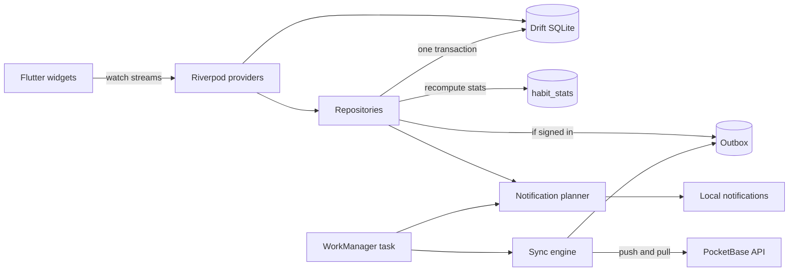

# Emberday

**A habit tracker with honest streaks that live on your phone.**


<!-- Add after build: docs/media/demo.gif and 4 screenshots (today, habit detail heatmap, stats, reminder help) -->

## Why this exists

Most habit apps make you pay for basics, ask for an account before you have built a single habit, or break your streak because you travelled, worked a night shift or lost signal. Emberday keeps everything on the device, calculates streaks with clear rules you can read, and reminds you without guilt.

It works the moment you open it. No account is needed. Sign in later only if you want backup or a second device.

## Features

- Pick starter habits or create your own (icon, color, schedule)
- Three schedule types: every day, specific weekdays, or N times per week
- One-tap check-in, skip a day without breaking the streak, backfill the last 7 days
- Streak engine with documented rules: current streak, best streak, 30-day completion rate
- Habit detail with a month heatmap and history
- Stats across all habits
- "Day starts at" setting so late-night check-ins count for the right day
- Reminders with a rolling schedule, cancelled automatically once you have done the habit
- Reminder help screen for phones that aggressively kill background apps
- Option to hide habit names in notifications
- Optional account for backup and multi-device sync
- JSON export of your data
- Light and dark themes, large touch targets, screen reader support

## How it works

1. Every screen reads from a local SQLite database (Drift), so nothing waits on the network.
2. Check-ins are rows keyed by habit and local date. Streaks are computed by a pure function and cached per habit in the same transaction as the write.
3. A notification planner decides which reminders to schedule over the next 7 days (within the platform limit) and the app applies that plan. A periodic background task tops it up.
4. If you sign in, an outbox pushes changes to the server with retries, and a pull merges changes from your other devices.

Full detail: [docs/architecture.md](docs/architecture.md).

## Tech stack

| Layer | Choice |
|---|---|
| App | Flutter, Dart 3 (null safety, sealed classes, records) |
| State | Riverpod (`flutter_riverpod`, no code generation) |
| Local data | Drift (SQLite) |
| Navigation | go_router |
| Notifications | flutter_local_notifications with timezone data |
| Background | workmanager (Android WorkManager, iOS BGTaskScheduler) |
| Secure storage | flutter_secure_storage |
| Connectivity | connectivity_plus |
| Backend | PocketBase with hooks |
| Errors | Sentry SDK pointed at self-hosted GlitchTip (optional) |
| Tests | flutter_test, mocktail |

Everything is free and self-hostable. No paid services, no analytics SDKs.

## Architecture



## Getting started

### Prerequisites

- Flutter SDK (stable channel) with Dart 3
- Android Studio or VS Code with an emulator or a physical phone
- A PocketBase binary (pinned version in `backend/PB_VERSION`), only for the optional sync

### Run the app (local-only)

```bash
flutter pub get
dart run build_runner build --delete-conflicting-outputs
cp .env.example .env
flutter run
```

### Run the backend (optional)

```bash
cd backend
./pocketbase superuser create you@example.com 'choose-a-strong-password'
./pocketbase serve --http=0.0.0.0:8090
```

(On older PocketBase versions the command is `admin create`.) Set `API_URL` in `.env`:

| Device | URL |
|---|---|
| Android emulator | `http://10.0.2.2:8090` |
| Phone on the same Wi-Fi | `http://<your-computer-LAN-IP>:8090` |
| Phone over USB (after `adb reverse tcp:8090 tcp:8090`) | `http://localhost:8090` |

Use HTTPS beyond local demos.

### Commands

| Command | Purpose |
|---|---|
| `flutter run` | Run the app |
| `flutter test` | Run unit and widget tests |
| `flutter analyze` | Static analysis |
| `dart run build_runner build --delete-conflicting-outputs` | Generate Drift code |
| `flutter build apk --release --split-per-abi` | Release build for measuring size and performance |

Measure performance in profile or release mode only, never debug.

## Project structure

```text
emberday/
  lib/
    main.dart, app.dart
    core/            clock, ids, logger, result, errors, dates
    data/
      db/            Drift database, tables, DAOs
      repositories/  habits, check_ins, settings, outbox
      sync/          outbox, engine, push, pull, backoff, merge
    domain/          models, schedule, streak_engine, notification_planner
    features/        today, habits, stats, settings, onboarding, account
    notifications/   scheduler (applies the plan), channels, permissions
    background/      callback dispatcher and tasks
    ui/              theme tokens, shared widgets, painters
  test/
  backend/           pb_hooks, pb_migrations
  docs/              design, story, demo, prd, cursorcontext, architecture
```

## Testing

`flutter test` covers the streak engine (table-driven cases for each schedule type, skips, rollover, backfill), the notification planner (limits, skipping completed days), recurrence of dates across month and year boundaries, the sync engine against a fake server with injected failures, and widget tests for the Today screen. The manual matrix is in [docs/architecture.md](docs/architecture.md#14-testing-strategy).

## Known limitations

- Changing a habit's schedule recalculates past streaks (the app warns first)
- Reminders on phones with aggressive battery management can be delayed or dropped; the help screen explains the fix
- iOS background refresh is opportunistic, so the planner also tops up when the app opens
- The local database is not encrypted at rest
- Last-write-wins sync per record
- No home-screen widget yet

## Roadmap

- Numeric goals (for example 8 glasses)
- JSON import
- Home-screen widget
- Skip reasons
- Backend move to Go or Python with Postgres using the same protocol

## Documentation

| Doc | Contents |
|---|---|
| [prd.md](docs/prd.md) | Problem, scope, user stories, acceptance criteria |
| [design.md](docs/design.md) | UI/UX, tokens, screens, patterns replicated |
| [architecture.md](docs/architecture.md) | Data model, streak rules, reminders, background work, sync |
| [story.md](docs/story.md) | The narrative and interview talking points |
| [demo.md](docs/demo.md) | Demo script and recording guide |

## License

MIT