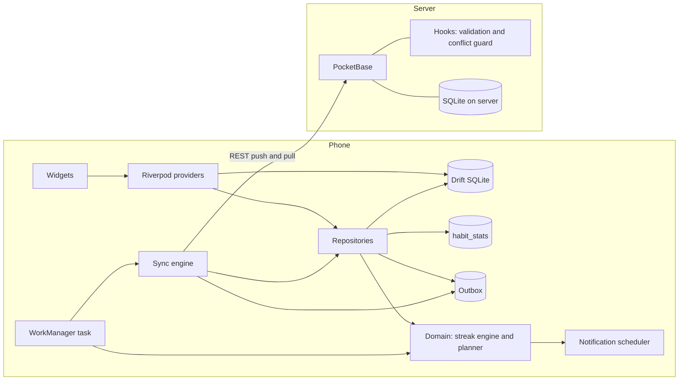

# Emberday: Architecture

## 1. Overview and principles

Emberday is local-first. The device database is the source of truth. The server is an optional backup and sync target for one user across devices.

| Principle | Where it lives |
|---|---|
| Offline-first, local DB as source of truth | `lib/data/db`, all reads through Drift streams |
| Pure, tested domain logic | `lib/domain` (streaks, schedules, notification planning) |
| Time as an injected dependency | `lib/core/clock.dart` |
| Cached derived data kept consistent | `habit_stats`, recomputed in the same transaction |
| Separation of planning and applying | `notification_planner.dart` vs `notifications/scheduler.dart` |
| Background work | `workmanager` top-up task, own DB connection |
| Queue-and-retry writes | `data/sync/*` (only when signed in) |
| Idempotency | Deterministic check-in and notification IDs, client IDs |
| Graceful degradation | Fully usable with no network, account or notification permission |
| Error handling and resilience | Error taxonomy, global handlers, parked sync ops |
| Secure storage | `flutter_secure_storage`; owner-scoped server rules |
| Observability | Logger interface with optional GlitchTip |

## 2. System context



## 3. Client architecture

Layers: **features** (widgets and providers), **domain** (pure Dart), **data** (repositories, Drift, sync, API), **notifications** and **background** (platform glue). Dependencies point inward: features depend on data and domain; domain depends on nothing.

State separation:
- Persistent data: Drift tables, exposed as streams
- UI-only state: Riverpod `StateProvider` and `Notifier` (selected date, sheet state, theme choice)
- Derived: `todayHabitsProvider` combines habits, check-ins for the selected date and cached stats
- Sync status: derived from connectivity, engine state, outbox counts and whether signed in

Providers (manual, no codegen): `databaseProvider`, `clockProvider`, `settingsProvider`, `habitsStreamProvider`, `checkInsForDateProvider(date)`, `habitStatsProvider(habitId)`, `reminderPlanProvider`, `syncStatusProvider`.

## 4. Local data model

Timestamps are integer milliseconds since epoch. Dates are local `YYYY-MM-DD` strings.

```sql
CREATE TABLE habits (
  id TEXT PRIMARY KEY,
  name TEXT NOT NULL,
  icon TEXT NOT NULL,
  color_key TEXT NOT NULL,                 -- 'habit1'..'habit8'
  schedule_type TEXT NOT NULL CHECK (schedule_type IN ('daily','weekdays','weekly_target')),
  weekdays_mask INTEGER NOT NULL DEFAULT 127,   -- bit 0 = Monday .. bit 6 = Sunday
  weekly_target INTEGER NOT NULL DEFAULT 0,     -- 1..7 when schedule_type = weekly_target
  start_date TEXT NOT NULL,
  reminder_enabled INTEGER NOT NULL DEFAULT 0,
  reminder_minutes INTEGER,                -- minutes after midnight, local
  reminder_weekdays_mask INTEGER NOT NULL DEFAULT 127,
  sort_order REAL NOT NULL DEFAULT 0,
  archived_at INTEGER,
  created_at INTEGER NOT NULL,
  updated_at INTEGER NOT NULL,
  deleted_at INTEGER
);

CREATE TABLE check_ins (
  id TEXT PRIMARY KEY,                     -- deterministic: 'ci' + 13 hex of SHA-256(habitId:date)
  habit_id TEXT NOT NULL REFERENCES habits(id),
  local_date TEXT NOT NULL,
  status TEXT NOT NULL CHECK (status IN ('done','skipped')),
  note TEXT,
  created_at INTEGER NOT NULL,
  updated_at INTEGER NOT NULL,
  deleted_at INTEGER,
  UNIQUE (habit_id, local_date)
);
CREATE INDEX idx_checkins_habit_date ON check_ins(habit_id, local_date DESC);

-- Local-only derived cache, never synced
CREATE TABLE habit_stats (
  habit_id TEXT PRIMARY KEY,
  current_streak INTEGER NOT NULL,
  best_streak INTEGER NOT NULL,
  total_done INTEGER NOT NULL,
  last_done_date TEXT,
  computed_for_date TEXT NOT NULL,         -- reference day used for the computation
  computed_at INTEGER NOT NULL
);

CREATE TABLE settings (
  key TEXT PRIMARY KEY,                    -- rollover_hours, theme, hide_names, sync_owner_id, last_plan_at
  value TEXT NOT NULL
);

CREATE TABLE outbox (
  seq INTEGER PRIMARY KEY AUTOINCREMENT,
  entity TEXT NOT NULL CHECK (entity IN ('habit','check_in')),
  entity_id TEXT NOT NULL,
  op TEXT NOT NULL CHECK (op IN ('create','update','delete')),
  payload TEXT NOT NULL,
  attempts INTEGER NOT NULL DEFAULT 0,
  next_attempt_at INTEGER NOT NULL DEFAULT 0,
  status TEXT NOT NULL DEFAULT 'pending' CHECK (status IN ('pending','parked')),
  last_error TEXT,
  created_at INTEGER NOT NULL
);

CREATE TABLE sync_state (
  key TEXT PRIMARY KEY,
  value TEXT NOT NULL
);
```

Notes:
- Enable foreign keys and WAL mode (verify Drift setup) so a background connection can read while the app writes.
- `habit_stats.computed_for_date` exists because "today pending" changes meaning when the date changes; stats are refreshed on app resume when the effective date has changed.
- The outbox is only written when signed in; first sign-in enqueues existing data (section 8.6).

## 5. Streak rules (the specification)

Definitions: the effective date of "now" is `localDate(now - rolloverHours)`. For a habit, only dates from `start_date` through the effective date are considered.

### 5.1 Day classification (daily and weekday schedules)

| Condition | Class |
|---|---|
| Not scheduled that weekday | `neutral` |
| Scheduled, check-in `done` | `done` |
| Scheduled, check-in `skipped` | `skipped` (neutral) |
| Scheduled, no check-in, date before today | `missed` |
| Scheduled, no check-in, date is today | `pending` |

### 5.2 Current streak

Start at the reference day: today if today is `done`; otherwise the day before today (today `pending` or `skipped` or `neutral` does not break anything). Walk backward over days:
- `done`: count one
- `skipped` or `neutral`: skip over, no count, no break
- `missed`: stop

Stop at `start_date`. If today is `skipped`, the walk starts from yesterday, so the streak is neither extended nor broken.

### 5.3 Best streak

The longest run of consecutive `done` days over the history, using the same rule that `skipped` and `neutral` days neither extend nor break a run and a `missed` day ends it.

### 5.4 Weekly target habits

For each Monday to Sunday week from the week containing `start_date`:
- Week is `met` if `done` count is at least `weekly_target`
- The current week is `pending` if unmet and not yet ended
- Past unmet weeks are `failed`, except the first week, which is neutral unless met

Current streak: consecutive `met` weeks ending at the most recent completed week, plus the current week if it is already met. A `failed` week stops the run. Best streak: longest run of `met` weeks.

### 5.5 Completion rate

- Day-based: `done / (scheduled days that are not skipped)` over the last 30 effective days (days before start ignored); if the denominator is zero, show "No data yet"
- Weekly target: `met weeks / completed weeks` over the last 12 weeks

### 5.6 Worked examples (include in tests)

| Case | Result |
|---|---|
| Daily habit, done Mon to Wed, today is Thursday with no check-in | Current 3 (today pending) |
| Same, but Wednesday was skipped | Current 2 (skip neutral) |
| Same, but Tuesday had no check-in | Current 1 (Wed done, Tue missed) |
| Mon/Wed/Fri habit, done Mon, Wed, Fri, today is Saturday | Current 3 (Sat and Sun neutral) |
| Mon/Wed/Fri habit, missed Wed, done Fri | Current 1 |
| 3 per week, week 1 done on 3 days, week 2 done on 2 days, now in week 3 | Current 0 (week 2 failed); best 1 |
| Check-in at 01:00 with rollover 3 | Counts for the previous local date |
| Habit started today, no check-in | Current 0, not broken |

### 5.7 Cache refresh

After any check-in or habit change for habit H, recompute H's stats in the same transaction using the engine and store them in `habit_stats`. On app resume, if the effective date changed since `computed_for_date`, recompute all non-archived habits.

## 6. Reminders

### 6.1 Planning (pure)

```text
planReminders(habits, checkInsByHabitDate, now, rolloverHours, horizonDays = 7, cap = 60, hideNames)
```

For each habit with reminders enabled and each day D from today to today + 6:
1. Skip if the habit's reminder weekday mask excludes D
2. For `daily` and `weekdays` habits, skip if D is not a scheduled day; weekly-target habits are eligible on any allowed day
3. Skip if the check-in for D is `done` or `skipped`
4. fireAt = D at `reminder_minutes` local time; skip if fireAt is not after `now`
5. ID = 31-bit integer from SHA-256(`habitId|D`)

Sort by fireAt, keep the first `cap`. Cap 60 stays under the iOS pending limit of 64 (verify the limit in current platform docs).

Note: "today" here is the calendar day, not the rollover-shifted day, because a notification fires on a wall-clock time; the done-check uses the check-in for the effective date that corresponds to D.

### 6.2 Applying (platform)

`NotificationScheduler.apply(plan)`:
1. Cancel this app's pending notifications
2. Schedule each planned notification with `zonedSchedule` (timezone initialized from the device's IANA name via `flutter_timezone`; inexact scheduling that allows while idle)
3. Record `last_plan_at` and the scheduled count in settings (shown on the help screen)

Cancel-and-reschedule is idempotent and simple. For an app with at most 60 notifications it is cheap.

### 6.3 Triggers

App start (after first frame), app resume, habit create, edit or delete, check-in change, settings change (including hide names), sync pull merging habits or check-ins, and the periodic background task.

### 6.4 Permission flow

- Never requested at launch
- Requested when the user first turns a reminder on (Android 13+ notification permission; iOS authorization)
- Denied: store the state, show "Reminders are off" with a button to system settings, keep reminder settings saved
- If the plan is empty or permission is off, the scheduler cancels pending notifications and returns

### 6.5 Reliability and honesty

Delivery is subject to OS and vendor battery management. The app: replans on every open, runs a periodic top-up, uses inexact scheduling (no special permission), and provides the help screen with a test reminder. It does not promise exact delivery.

### 6.6 Android configuration (verify with the plugin README)

Boot receiver and notification channel, core library desugaring if required, notification icon resource, permission entries in the manifest, release-build shrinker rules if required.

## 7. Background work

### 7.1 Task

A `workmanager` periodic task registered after first run (target every 6 hours; the Android minimum interval is 15 minutes; iOS scheduling is opportunistic).

```text
topUp():
  1. Open a database connection (own connection, same file, WAL)
  2. Load habits, check-ins and settings
  3. plan = planReminders(...); scheduler.apply(plan)
  4. If signed in and online: one bounded sync pass (drain then pull)
  5. Close the connection; return success
```

### 7.2 Constraints

- Runs in a separate isolate: no Riverpod providers, no Flutter UI, its own small dependency set
- Must initialize the notification plugin and timezone data itself
- Short and idempotent; safe if it overlaps with the foreground app (WAL mode, short transactions, retry on busy)
- If the task cannot run (OS restrictions), the app still replans on open

### 7.3 Failure handling

Errors are logged with class only and the task returns success to avoid aggressive retry backoff by the OS, except for transient sync errors that the sync engine already schedules.

## 8. Sync (optional, only when signed in)

### 8.1 Account model

- Not signed in: no outbox rows, no network calls
- Signed in: every write also inserts an outbox row in the same transaction
- `sync_owner_id` ties local data to an account; signing in as a different user prompts: replace local data (wipe, then pull) or cancel

### 8.2 Write path

Repository transaction (entity change, stats recompute, outbox insert) commits, Drift streams emit, then `requestSync()` (debounced) and `replanReminders()` run.

### 8.3 Coalescing

| Sequence | Result |
|---|---|
| create then updates | One create with final state |
| updates then updates | One update with latest values |
| create then delete (never synced) | Both dropped |
| updates then delete | One delete |

### 8.4 Drain and errors

Process by `seq`, habits before check-ins. Backoff: min(300 s, 2 s * 2^attempts) with plus or minus 20% jitter; reset when connectivity returns or the app resumes. Stop the drain on retryable errors to preserve ordering. Error handling is in section 10.

### 8.5 Pull and merge

- Cursor per collection in `sync_state`; request `updated >= cursor`, sorted `updated,id`, 200 per page
- Apply each page in one transaction, skipping records with pending outbox ops; apply server tombstones as `deleted_at`
- Recompute stats for affected habits in the same transaction, then replan reminders after commit
- Triggers: app resume, connectivity regained, after a successful drain, background task, manual refresh (no realtime; single user)

### 8.6 First sign-in

Enqueue creates for all non-deleted habits and check-ins, push, then pull. Deterministic check-in IDs mean a second device's overlapping check-ins merge instead of duplicating.

### 8.7 Conflicts

Single LWW timestamp per record. The server clamps timestamps more than 5 minutes ahead and returns 409 `stale_write` for older writes; the client applies the server record. A later check-in change replaces an earlier one for the same habit and date. Clock skew can lose ties (documented limitation).

### 8.8 Sync status

Not signed in: no chip. Signed in: Offline, Syncing, Issue (parked ops or auth needed), Pending, Up to date.

## 9. Backend (PocketBase)

Pin the version in `backend/PB_VERSION` and read that version's docs before writing hooks. Verify field, rule and hook syntax and the behavior of client-supplied IDs.

### 9.1 Collections

Both collections carry an `owner` relation to `users`, `client_updated_at` (number), and optional `deleted_at` (number). PocketBase `updated` is the pull cursor.

| Collection | Fields |
|---|---|
| `habits` | `name`, `icon`, `color_key`, `schedule_type`, `weekdays_mask`, `weekly_target`, `start_date`, `reminder_enabled`, `reminder_minutes`, `reminder_weekdays_mask`, `sort_order`, `archived_at` |
| `check_ins` | `habit` (text id), `local_date` (text `YYYY-MM-DD`), `status`, `note` (up to 280) |

Add a unique index on (`owner`, `habit`, `local_date`) for `check_ins`.

### 9.2 API rules (starting point; test in the Admin UI rule tester)

| Operation | Rule |
|---|---|
| List and view | `@request.auth.id != "" && owner = @request.auth.id` |
| Create | `@request.auth.id != "" && @request.body.owner = @request.auth.id` |
| Update | `@request.auth.id != "" && owner = @request.auth.id && @request.body.owner:isset = false` |
| Delete | none (soft delete only) |

### 9.3 Hooks

- Validate: names up to 60 chars, notes up to 280, `local_date` matches `YYYY-MM-DD` and is a real date, masks within range, `weekly_target` 1 to 7 when applicable
- Conflict guard on update: clamp `client_updated_at` to server now if more than 5 minutes ahead; if older than the stored value, respond 409 `stale_write` with the current record
- Duplicate create (same client ID) returns the existing-record error the client treats as success after a GET (verify behavior)

### 9.4 Operations

Run locally with `./pocketbase serve --http=0.0.0.0:8090`, commit `pb_migrations`, use PocketBase backups for any hosted instance, HTTPS beyond local demos.

## 10. Error handling

| Class | Examples | Retry | User sees | Log |
|---|---|---|---|---|
| network | timeout, no connection | Yes, backoff | Chip: Offline or Pending (signed in only) | breadcrumb |
| transient | 5xx, 429 (respect Retry-After) | Yes, backoff | Chip: Pending | warn |
| auth | 401 | Refresh once, then park and prompt | Banner: "Sign in again to resume backup" | info |
| forbidden | 403 | No, park | Sync center entry | error |
| validation | 400, 422 | No, park | Sync center entry with plain reason | error (ids only) |
| conflict | 409 `stale_write` | Resolved by applying server record | Nothing | info |
| notFound | 404 on delete | Treated as success | Nothing | debug |
| local | database failure | No | Recovery screen with Restart | error |
| permission | notification permission denied | No | "Reminders are off" with system settings button | info |
| unknown | uncaught exceptions | n/a | Global handler and route fallback | error |

Rules: never show raw exception text; never log habit names, notes or emails; never clear local data because of network or auth errors.

## 11. Performance plan

| Concern | Approach |
|---|---|
| Startup | Initialize only the database and theme before the first frame; defer notification plan, background registration and sync boot until after it |
| Rendering | `ListView.builder`, `const` widgets, `select` on providers to limit rebuilds, `RepaintBoundary` around heatmap and ring |
| Queries | Drift streams scoped to the selected date; per-habit stats read from `habit_stats`, not recomputed per frame |
| Painters | Heatmap and bars cache paths and paint objects; no allocations per frame |
| Writes | One transaction per user action |
| Bundle | No chart or UI kit packages; release build with split-per-abi |
| Measurement | Profile mode on a low-end device with 50 habits and 3 years of generated history; DevTools frame timings; cold start with `adb shell am start -W` on a release build; APK size from `--split-per-abi` output |

Budgets: cold start under 2 s, under 1% frames over budget, interaction under 100 ms, APK per ABI under 30 MB.

## 12. Security and privacy

- Token in `flutter_secure_storage`; never logged
- No analytics SDKs; nothing leaves the phone unless the user signs in
- Owner-scoped API rules, verified by a manual cross-account test
- HTTPS beyond local demos
- Option to hide habit names in notifications (lock-screen privacy)
- Account guard prevents merging two people's data on one phone
- Local database is not encrypted at rest (documented limitation)
- No secrets in the repo; `.env` carries only the API URL and an optional error-reporting DSN

## 13. Observability

- `Logger` interface with console and optional Sentry (GlitchTip DSN) implementations
- Breadcrumbs for sync events, plan applications (count only) and background runs with ids and counts only
- The reminders help screen and sync center act as in-app diagnostics
- PocketBase admin logs for server-side issues

## 14. Testing strategy

**Domain (flutter_test):** streak engine table (40+ cases across daily, weekdays, weekly target, skips, missed, today pending, backfill, start date, rollover, month, year and leap-day boundaries), schedule helpers, notification planner (cap, past times, done and skipped days, masks, ID stability, hide names).

**Data:** repositories with an in-memory Drift database; stats consistency test (random operations, cache equals recomputation).

**Sync:** engine against a fake server with injected failures: network error, 500, 429, 401, 409, duplicate create, crash between server success and outbox delete.

**Widget:** Today toggle and skip, empty state, schedule picker.

**Manual matrix:**

| # | Scenario | Expected |
|---|---|---|
| 1 | Airplane mode: create habits and check in for several days | Works; streaks correct; no network calls |
| 2 | Set day start 3 AM, check in at 01:00 (use the dev clock) | Counts for the previous date |
| 3 | Mon/Wed/Fri habit across a weekend | Weekend does not break the streak |
| 4 | Skip a day, then check in the next | Streak continues unchanged by the skip |
| 5 | Backfill a missed day | Streak recalculates immediately |
| 6 | Change a schedule on a habit with history | Warning appears; past streaks recalculate |
| 7 | Enable a reminder, complete the habit before the time | No notification fires for today |
| 8 | Deny notification permission | Clear message and settings button; app remains fully usable |
| 9 | Reboot the phone, wait for a reminder time | Reminder fires or the app tops up on next open (record which) |
| 10 | Change device timezone | Existing check-ins stay on their dates; reminders re-plan in the new zone |
| 11 | 24-hour reminder test on a real phone | Record on-time count and battery settings |
| 12 | Sign in on two devices, check in on both for the same day | One record, no duplicate |
| 13 | Kill the app mid-sync | Resumes; no loss or duplicates |
| 14 | Sign in as a different account on a used phone | Replace-or-cancel prompt |
| 15 | Cross-account API request | Rejected |
| 16 | 50 habits with 3 years of history | Today scrolls smoothly in profile mode |

## 15. Architecture decision records

| ADR | Decision | Alternatives | Why |
|---|---|---|---|
| 1 | Drift for local data | sqflite, Isar, Hive | Typed queries, streams, SQL control, migration support |
| 2 | Riverpod without codegen | Bloc, Riverpod generator | Fewer moving parts; Drift already needs build_runner |
| 3 | Check-ins as rows per (habit, date) | Counters, event log | Simple, queryable, easy to sync and backfill |
| 4 | Streaks from a pure engine, cached per habit | SQL-only streaks, stored counters | Complex rules are testable in Dart; cache gives instant UI |
| 5 | Skipped is a neutral status | Skip counts as done, skip breaks | Honest and forgiving |
| 6 | Local date strings plus rollover hours | UTC instants | Day belongs to the user; stable across timezones |
| 7 | Rolling 7-day notification window with cap | Repeating notifications | Can cancel a completed day; fits platform limits |
| 8 | Planner and scheduler separated | Direct scheduling in features | Planner is pure and testable |
| 9 | Inexact scheduling | Exact alarms | No special permission; nudges do not need exactness |
| 10 | Deterministic check-in IDs | Random IDs | Cross-device idempotency |
| 11 | Optional account with outbox sync | Mandatory signup | Time-to-value and privacy |
| 12 | LWW per record | CRDTs | Single-user data, low conflict risk |

## 16. Scaling limits and upgrade path

PocketBase is a single node with SQLite: fine for personal data at portfolio scale. To scale, reimplement the push, pull and cursor protocol in Go or Python on Postgres with per-owner row-level security. The client's repositories, outbox and merge stay the same; only the API adapter and server-side guard change.

## 17. Open questions

- Which Drift setup works for a second connection in the background isolate (separate connection with WAL, or Drift's isolate support)?
- Does `workmanager` run periodic tasks reliably enough on the target test phone, and what is the iOS behavior?
- Current `flutter_local_notifications` API for inexact scheduling and its Android desugaring requirement
- Does the PocketBase Dart SDK accept client-supplied IDs on create, and what does it return for duplicates?
- Does the in-memory Drift database run under `flutter test` on the host machine without extra setup?
- Should skips have a limit, or should weekly-target weeks start on a configurable day?